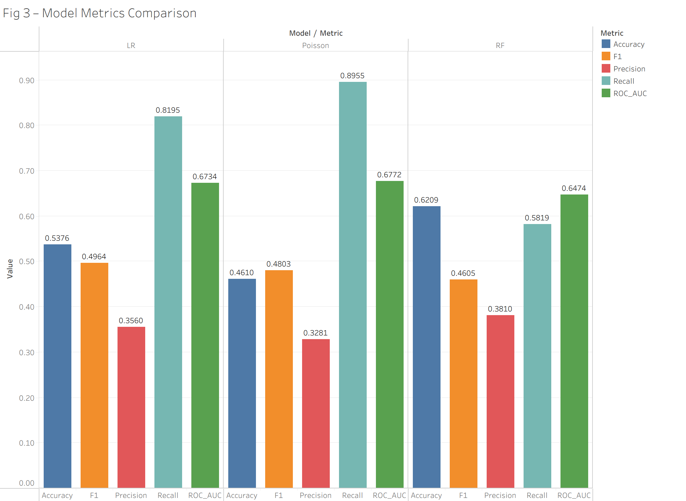
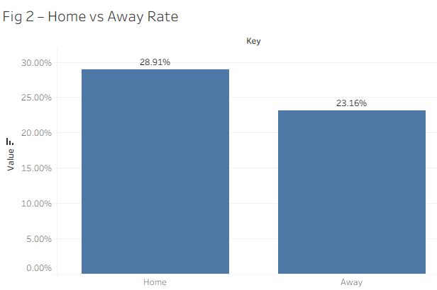
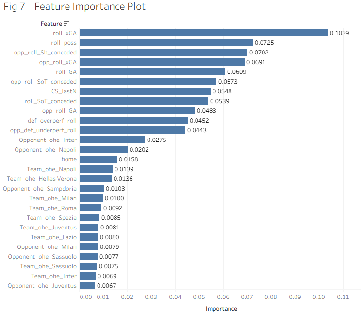

# Serie A Clean Sheet Prediction

**Will this team keep a clean sheet in its next match?** A forecasting model for Serie A, built with PySpark on 3,800 team-matches from five seasons (2020/21 to 2024/25).

For every upcoming match, it uses only what was known before kick-off (each team's last five games) to estimate the chance of conceding zero goals. It then sorts matches into Low, Medium and High clean-sheet readiness. It was tested on two later seasons it never saw.



## Key findings

- **Clean sheets are rare and lean towards home teams.** About 1 in 4 team-matches ends with a clean sheet: 28.9% at home against 23.2% away.
- **Recent defence is the strongest signal.** The team's xG conceded over its last five matches matters most, followed by its possession and how many shots and how much xG the opponent has recently conceded.
- **The readiness bands separate matches clearly.** Teams rated **High** kept a clean sheet in 39% of test matches, **Medium** in 31%, and **Low** in 16%, a 2.5× gap between top and bottom.
- **Predicting goals beats predicting yes/no.** A Poisson model of goals conceded, turned into a clean-sheet probability, ranks matches best and gives the most trustworthy probabilities.

## Highlights

- **Honest evaluation.** Models train on 2020/21 to 2022/23 and are tested on 2023/24 and 2024/25. Tuning uses 2022/23 only, so the test seasons never influence any decision. The best model reaches PR-AUC 0.425, against 0.278 for random guessing.
- **Calibrated probabilities.** The Poisson model predicts an average clean-sheet chance of 28.3% on the test seasons, where the real rate was 27.8%.
- **Improved after finding flaws in my own work.** A re-check found three problems: a team-name mismatch that silently dropped Inter's matches, tuning that peeked at the test seasons, and metrics that overstated how well the models find clean sheets. All three are fixed. See [Version history](docs/technical.md#version-history).

**Tech stack:** Python, PySpark (Spark ML: logistic regression, random forest, Poisson regression), pandas, Tableau.

## Results

Home teams keep more clean sheets (left), and recent xG conceded is the random forest's most important feature (right).

<p>
  
  
</p>

The charts come from Tableau workbooks in [`figures/`](figures/) (open with Tableau Public), built from the CSVs in `outputs/`. Full results, confusion matrices included, are in [docs/technical.md](docs/technical.md#evaluation).

## Run it

Python 3.12 and Java 17 (needed by Spark).

```bash
pip install -r requirements.txt
python main.py   # about 1 minute; writes outputs/*.csv
```

Tuning and other options are in [docs/technical.md](docs/technical.md#running-and-tuning).

## Data

[Serie A Matches Dataset 2020–2025](https://www.kaggle.com/datasets/marcelbiezunski/serie-a-matches-dataset-2020-2025) on Kaggle: 3,800 team-match rows (each match from both sides) with goals, xG, shots, possession and venue.

## Limitations

- **Sample size**: about 1,500 test team-matches, so small gaps between models are within noise.
- **Short memory**: features cover only the last five matches.
- **Team identity**: one-hot team columns can't describe newly promoted teams.
- **Tuning features**: tuning uses a simpler feature set than the final models.

**Next steps** that would improve it: longer and weighted form (season-to-date, Elo ratings), a comparison against bookmaker odds, and a season-by-season backtest with confidence intervals.

Method, full results, project layout and version history: [docs/technical.md](docs/technical.md)
