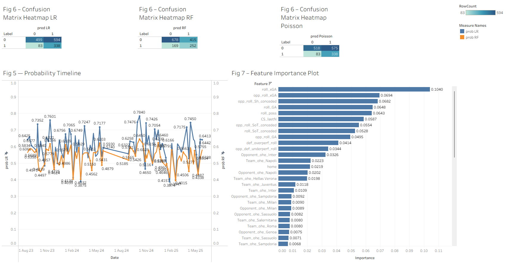
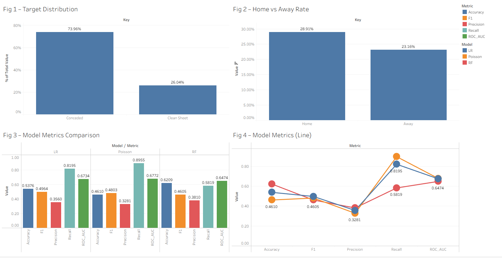

# Serie A Clean Sheet Prediction

**Will this team keep a clean sheet in its next match?** A forecasting model for Serie A, built with PySpark on 3,800 team-matches from five seasons (2020/21 to 2024/25).

For every upcoming match, it uses only what was known before kick-off (each team's last five games) to estimate the chance of conceding zero goals. It then sorts matches into Low, Medium and High clean-sheet readiness. It was tested on two later seasons it never saw.



## Key findings

- **Clean sheets are rare and lean towards home teams.** About 1 in 4 team-matches ends with a clean sheet: 28.9% at home against 23.2% away.
- **Recent defence is the strongest signal.** The team's xG conceded over its last five matches matters most, followed by its possession and how many shots and how much xG the opponent has recently conceded (a proxy for the opponent's overall strength).
- **The readiness bands separate matches clearly.** Teams rated **High** kept a clean sheet in 39% of test matches, **Medium** in 31%, and **Low** in 16%, a 2.5× gap between top and bottom.
- **Predicting goals beats predicting yes/no.** A Poisson model of goals conceded, turned into a clean-sheet probability, ranks matches best and gives the most trustworthy probabilities.

## Highlights

- **Honest evaluation.** Models train on 2020/21 to 2022/23 and are tested on 2023/24 and 2024/25. Hyperparameters are tuned on 2022/23 only, so the test seasons are never used for any decision.
- **Calibrated probabilities.** The Poisson model predicts an average clean-sheet chance of 28.3% on the test seasons, where the real rate was 27.8%.
- **Improved after reviewing my own work.** A re-check found three flaws in the original version: a team-name mismatch that silently dropped Inter's matches, tuning that peeked at the test seasons, and metrics averaged over both classes that overstated performance. All three are fixed. See [Version history](#version-history).

**Tech stack:** Python, PySpark (Spark ML: logistic regression, random forest, Poisson regression), pandas, Tableau.

## How it predicts a clean sheet

1. **Features from the last five matches** (never including the match being predicted):
   - **team defence:** goals, xG and shots on target conceded, possession, clean-sheet rate, and goals conceded beyond xG
   - **opponent:** its recent goals, xG, shots and shots on target conceded
   - **context:** home or away, team and opponent identity
2. **Three models:**
   - **logistic regression**, class-weighted
   - **random forest**, class-weighted, with Platt-calibrated probabilities
   - **Poisson regression**, which predicts expected goals conceded (λ) and converts it with **P(clean sheet) = e^(−λ)**
3. **Readiness bands** come from the calibrated random forest, using cut-offs set on the training seasons.

How each model does on the two test seasons (1,514 team-matches). Precision, recall and F1 refer to the clean-sheet class:

| Model | ROC-AUC | PR-AUC | Precision | Recall | F1 | Brier (lower is better) |
|---|---|---|---|---|---|---|
| Logistic regression | 0.673 | 0.408 | 0.356 | 0.819 | **0.496** | 0.233 |
| Random forest | 0.647 | 0.390 | **0.381** | 0.582 | 0.461 | 0.191 |
| **Poisson regression** | **0.677** | **0.425** | 0.328 | **0.895** | 0.480 | **0.186** |
| No-skill baseline | 0.500 | 0.278 | – | – | – | 0.202 |

- **Well above chance:** PR-AUC 0.425 against 0.278. Matches in Poisson's top fifth ended in a clean sheet 47% of the time, against 13% in its bottom fifth.
- **Accuracy isn't the target.** Always predicting "conceded" would be 72% accurate but would never find a clean sheet. The models trade accuracy for recall: Poisson catches 90% of actual clean sheets.
- **Use Poisson or the random forest for probabilities.** Class weighting inflates logistic regression's probabilities (average 49% against a real 28%), so it is best used for yes/no flags.



The dashboards are Tableau workbooks in [`figures/`](figures/) (open with Tableau Public) and read the CSVs in `outputs/`.

## Running it

Python 3.12 and Java 17 (needed by Spark).

```bash
python -m venv .venv
.venv\Scripts\activate          # macOS/Linux: source .venv/bin/activate
pip install -r requirements.txt

# build features, train and evaluate all three models, write outputs/*.csv (about 1 minute)
python main.py

# optional: re-select hyperparameters on the 2022/23 validation season (about 20 minutes)
python tuning/tune.py
```

`main.py` reads its settings from `tuning/best_params.json`, so re-running the tuning feeds straight into the next run. Both scripts accept `--csv_path` and `--out_dir`.

## Data

[Serie A Matches Dataset 2020–2025](https://www.kaggle.com/datasets/marcelbiezunski/serie-a-matches-dataset-2020-2025) on Kaggle. It has 3,800 team-match rows (each match appears once from each side) with goals, xG, shots, shots on target, possession and venue. Inter appears as "Internazionale" in one column and "Inter" in another; the code standardises this to "Inter".

## Limitations

- **Sample size:** the test set is about 1,500 team-matches, so differences of 0.01 to 0.02 AUC between models are within noise.
- **Short memory:** features cover only the last five matches, so one heavy defeat can swing them.
- **Opponent features describe the opponent's defence,** which acts as a strength proxy. Versions based on the opponent's attack were tested and did not improve results.
- **Team identity:** one-hot team columns can't describe newly promoted teams, and they fade as squads change.
- **Different feature sets:** tuning uses a simpler feature set than the final models.

**Next steps** that would improve it: longer and weighted form (season-to-date, exponentially weighted, Elo ratings), a comparison against bookmaker odds, and a season-by-season backtest with confidence intervals.

## Project layout

```
main.py                   pipeline: load, mirror join, rolling features, split, models, metrics, exports
tuning/
  tune.py                 time-aware hyperparameter search (logistic regression, random forest, Poisson)
  best_params.json        selected settings, read by main.py
  tuning_results.csv      every setting tried, with validation scores
matches_serie_A.csv       raw match data
requirements.txt

produced by main.py:
outputs/
  model_metrics.csv           test metrics for each model
  model_predictions.csv       per-match probabilities, predictions and readiness band
  rf_feature_importances.csv  random-forest feature importance
  dataset_summary.csv         class balance, home vs away rate, matches per season

figures/
  fig1-4.twb, fig5-7.twb      Tableau workbooks
  dashboard_*.png             dashboard images used in this README
```

## Version history

- **v2 (current).** Added the Poisson model and clean-sheet-class metrics. Tuning now validates on 2022/23 only. Inter's matches are restored, opponent features are named for what they measure, and paths and the environment make the project reproducible from a fresh clone.
- **v1 (original).** Logistic regression and random forest with hardcoded settings. A review found three problems:
  - a team-name mismatch ("Internazionale" vs "Inter") silently dropped about 5% of matches
  - hyperparameters were tuned on a validation window that overlapped the test seasons
  - precision, recall and F1 were averaged over both classes, which made the models look better at finding clean sheets than they were (weighted precision about 0.68 against a clean-sheet precision of about 0.36)

  It also ran only on the original machine: it used absolute paths and a committed virtual environment.
