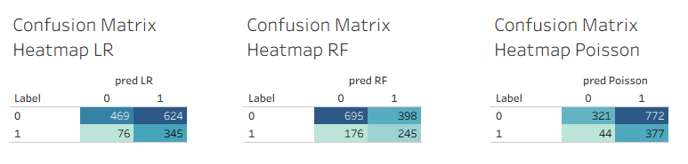

← [Back to README](../README.md)

# Serie A Clean Sheet Prediction: technical details

## How it works

1. **Target**: `cs = 1` if the team conceded 0 goals in the match.
2. **Features from the last five matches.** Rolling windows exclude the current game, so nothing from the match being predicted leaks in.
   - **Team defence**:
     - goals, xG and shots on target conceded
     - possession
     - clean-sheet rate
     - goals conceded beyond xG (`def_overperf_roll`)
   - **Opponent**: its recent goals, xG, shots and shots on target **conceded**, and how far its goals conceded exceeded the xG it allowed. These describe the opponent's defence, which acts as a proxy for overall strength. Versions based on the opponent's attack were tested and did not improve results.
   - **Context**: home or away, plus team and opponent identity (one-hot).
   - **Mirror join**: shots conceded come from pairing each row with the opponent's view of the same match.
3. **Three models**:
   | Model | Idea |
   |---|---|
   | Logistic regression | Class-weighted to counter the 74/26 imbalance; L1-regularised |
   | Random forest | Class-weighted; probabilities calibrated with Platt scaling on a later slice of the training seasons |
   | Poisson regression | Predicts expected goals conceded (λ) and converts it with **P(clean sheet) = e^(−λ)**. It learns from full scorelines and needs no class weights |
4. **Readiness bands**: the calibrated random-forest probability, cut at the 40th and 80th percentiles of the training seasons (Low / Medium / High).

## Evaluation

- **Train**: 2020/21 to 2022/23 (2,242 team-matches)
- **Test**: 2023/24 and 2024/25 (1,514 team-matches)
- **Tuning**: `tuning/tune.py` trains on 2020/21 to 2021/22 and validates on 2022/23. The test seasons are never used for selection.

| Model | ROC-AUC | PR-AUC | Accuracy | Precision | Recall | F1 | Brier (lower is better) |
|---|---|---|---|---|---|---|---|
| Logistic regression | 0.673 | 0.408 | 0.538 | 0.356 | 0.819 | **0.496** | 0.233 |
| Random forest | 0.647 | 0.390 | 0.621 | **0.381** | 0.582 | 0.461 | 0.191 |
| **Poisson regression** | **0.677** | **0.425** | 0.461 | 0.328 | **0.895** | 0.480 | **0.186** |
| No-skill baseline | 0.500 | 0.278 | 0.722 | – | – | – | 0.202 |

Precision, recall and F1 refer to the **clean-sheet class**. The baselines are:
- **ROC-AUC 0.5:** random ranking
- **PR-AUC:** the test clean-sheet rate
- **Accuracy:** always predicting "conceded"
- **Brier:** always predicting the training clean-sheet rate

**How to read this**
- **Better than chance, honestly measured.** When Poisson rates a match in its top fifth, the team kept a clean sheet 47% of the time, against 13% in its bottom fifth.
- **Accuracy is deliberately not the goal.** Always predicting "conceded" scores 72% but never finds a clean sheet. The models trade accuracy for recall: Poisson catches 90% of actual clean sheets.
- **Use Poisson or the random forest for probabilities.** Poisson has the lowest Brier score and averages 28.3% against a real 27.8%. Class weighting inflates logistic regression's probabilities (average 49%), so it is best used for yes/no flags.
- **Readiness bands**: **High** 39% clean sheets, **Medium** 31%, **Low** 16%.
- **Sample size**: about 1,500 test team-matches, so differences of 0.01 to 0.02 AUC between models are within noise.

Confusion matrices on the test seasons: rows are the actual outcome (1 = clean sheet), columns the prediction.



## Data

[Serie A Matches Dataset 2020–2025](https://www.kaggle.com/datasets/marcelbiezunski/serie-a-matches-dataset-2020-2025) on Kaggle.
- **Size**: 3,800 team-match rows from 2020/21 to 2024/25 (5 seasons, 28 teams). Each match appears twice, once from each team's side.
- **Columns used**: date, season, team, opponent, venue, goals for and against, xG and xGA, shots, shots on target and possession.
- **Cleaning**: Inter appears as "Internazionale" in the `Team` column but "Inter" in `Opponent`. The code standardises both to "Inter". Without this, the mirror join fails and Inter's matches drop out.
- **Early-season rows**: rows without five previous matches are dropped.

## Running and tuning

Python 3.12 and Java 17 (needed by Spark).

```bash
python -m venv .venv
.venv\Scripts\activate          # macOS/Linux: source .venv/bin/activate
pip install -r requirements.txt

# build features, train and evaluate all three models, write outputs/*.csv (about 1 minute)
python main.py

# re-select hyperparameters on the 2022/23 validation season (about 20 minutes)
python tuning/tune.py
```

- **Shared options**: both scripts accept `--csv_path` and `--out_dir`.
- **`main.py`**: reads its settings from `tuning/best_params.json` (`--params` to use another file), so re-running the tuning feeds straight into the next run.
- **`tune.py`**: `--split_mode` defaults to `main`, which uses the same season boundaries as `main.py`.
- **Tableau**: after re-running `main.py`, refresh the extracts in Tableau (**Data → source → Extract → Refresh**) before taking new dashboard screenshots.

## Project layout

```
main.py                   pipeline: load, mirror join, rolling features, split, models, metrics, exports
tuning/
  tune.py                 time-aware hyperparameter search (logistic regression, random forest, Poisson)
  best_params.json        selected settings, read by main.py
  tuning_results.csv      every setting tried, with validation scores
matches_serie_A.csv       raw match data
requirements.txt

produced by main.py:
outputs/                  model results (see below)

figures/
  fig1-4.twb, fig5-7.twb  Tableau workbooks
  *.png                   charts exported from the workbooks, used in the README and this page
```

## Outputs

[`outputs/`](../outputs/) after `python main.py`:

- [`model_metrics.csv`](../outputs/model_metrics.csv): test metrics for each model
- [`model_predictions.csv`](../outputs/model_predictions.csv): per-match probabilities, yes/no predictions, expected goals conceded and readiness band
- [`rf_feature_importances.csv`](../outputs/rf_feature_importances.csv): random-forest feature importance
- [`dataset_summary.csv`](../outputs/dataset_summary.csv): class balance, home vs away clean-sheet rate, matches per season

## Version history

- **v2 (current).**
  - **Added:** the Poisson model, and clean-sheet-class metrics.
  - **Fixed:** tuning validates on 2022/23 only, Inter's matches are restored, and opponent features are named for what they measure.
  - **Portable:** the project runs from a fresh clone (relative paths, `requirements.txt`).
- **v1 (original).** Logistic regression and random forest with hardcoded settings. A review found three problems:
  - **Missing matches:** a team-name mismatch ("Internazionale" vs "Inter") silently dropped about 5% of matches.
  - **Leaky tuning:** hyperparameters were tuned on a validation window (October 2023 to August 2024) that overlapped the test seasons.
  - **Misleading metrics:** precision, recall and F1 were averaged over both classes. That made the models look much better at finding clean sheets than they were: weighted precision was about 0.68, against a clean-sheet precision of about 0.36.

  It also ran only on the original machine: it used absolute paths and a committed virtual environment.
